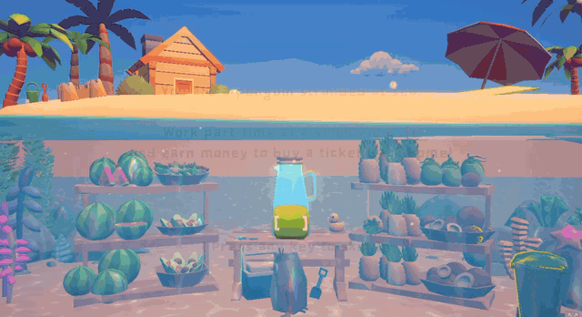
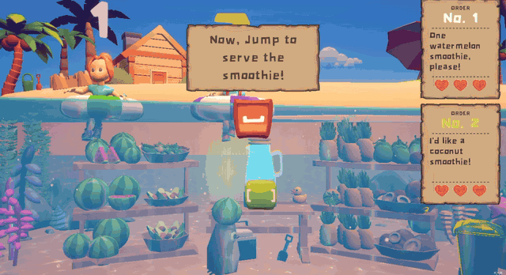

# PengCafe
## 플레이 화면

물 위의 손님이 주문하면 펭귄이 물속에서 재료를 골라 스무디를 만드는 카페 게임입니다. Comfy Jam: Summer 2026 출품작(2주, 1인 개발)으로, 평가받은 395개 작품 중 종합 48위를 기록했습니다.

- 플레이: https://tow0n.itch.io/pengcafe
- 스무디 제조는 재료 투입·혼합·완성 단계의 FSM으로 구현하고, 단계마다 진행 상태를 화면에 표시했습니다.

펭귄이 운영하는 바닷가 카페입니다. 물 위에서 손님의 주문을 받고, 물속에서 재료를 골라 스무디를 만든 뒤 다시 손님에게 돌아가 서빙합니다.

**[itch.io에서 플레이하기](https://tow0n.itch.io/pengcafe)**

| 개발 기간 | 인원과 역할 | 기술 | 배포 |
| --- | --- | --- | --- |
| 2026.06.06 ~ 06.20 | 1인 · 기획, 클라이언트 개발, 게임잼 제출 | Unity 6 · C# | itch.io |

이 저장소에는 게임에서 발췌한 C# 스크립트를 담았습니다. 완성 빌드는 위 플레이 링크에서 실행할 수 있습니다.

## 게임플레이 시연

**첫 스무디 튜토리얼과 상호작용 안내**

**재료를 선택하고 블렌더로 스무디를 만드는 과정**

이 GIF는 현재 플레이 장면으로, 튜토리얼 개선 전후를 비교한 영상은 아닙니다.

## 한 주문이 진행되는 과정

1. **주문 확인** — 물 위의 손님이 원하는 메뉴를 확인합니다.
2. **스무디 제조** — 물속에서 재료를 골라 믹서로 음료를 만듭니다.
3. **서빙** — 손님에게 돌아가 완성된 메뉴를 건넵니다.

손님과 주문 관련 코드는 [Customer](Scripts/Customer/Customer.cs), 음료 제조는 [Cooking](Scripts/Cooking/Blender.cs), 손님에게 메뉴를 건네는 동작은 [PenguinServer](Scripts/Player/PenguinServer.cs)에서 볼 수 있습니다.

## 플레이 테스트 · 첫 스무디에서 막힌 이유

개발 중 친구에게 처음부터 플레이해 달라고 부탁했습니다. 조작법을 글로 써 두었는데도 친구는 첫 주문을 받고 무엇부터 해야 할지 몰랐습니다. 스무디를 건넨 뒤에도 손님이 주문한 메뉴가 맞았는지 알기 어렵다는 피드백을 받았습니다.

- **재료 찾기** — 다음에 손대야 할 물건에 윤곽선을 표시했습니다.
- **조작 익히기** — 안내된 키를 직접 눌러야 다음 단계로 넘어가게 했습니다. 마지막 단계까지 따라가면 스무디 한 잔이 완성됩니다.
- **서빙 확인하기** — 주문과 맞는 메뉴를 건넸을 때와 틀린 메뉴를 건넸을 때 다른 효과음이 나도록 했습니다.

관련 코드 · [튜토리얼 진행](Scripts/UI/TutorialUI.cs) · [상호작용 대상 선택](Scripts/Player/PenguinInteractor.cs)

## AI와 나눈 일

초반에는 게임 시스템을 어떻게 나눌지 Claude에 물어본 뒤 직접 구현하기 시작했습니다. 마감이 가까워지면서 기능 코드를 작성하는 일도 상당 부분 Claude에 맡겼습니다. 친구가 막힌 지점을 보고 튜토리얼의 순서와 서빙 피드백을 어떻게 바꿀지는 제가 정했습니다.

## 게임잼 결과

Comfy Jam Summer 2026에서 평가를 받은 395개 작품 중 종합 48위를 기록했습니다. 오디오 26위, 테마 37위, 게임플레이 125위였습니다. [공식 결과 보기](https://itch.io/jam/comfy-jam-summer-2026/results?page=3)
